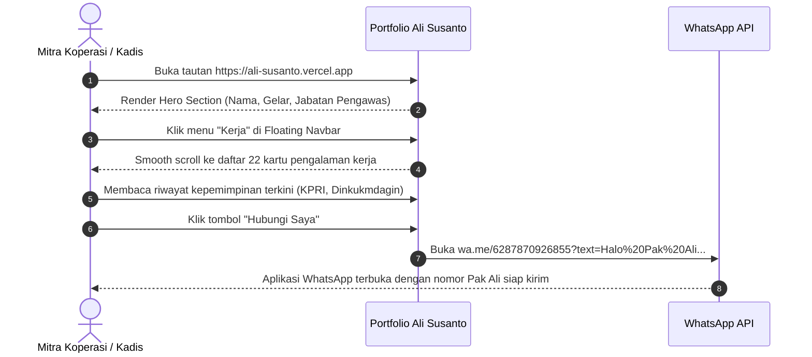
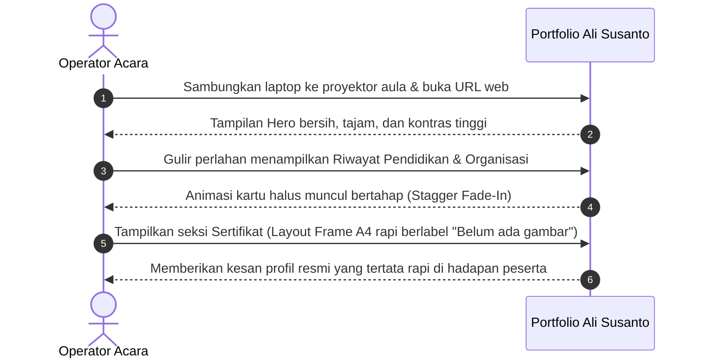

# DESIGN BRIEF & DESIGN SYSTEM SPECIFICATION (DESIGN.md)
**Produk:** Website Portfolio Eksekutif — Ali Susanto, S.Pt., M.Si.  
**Role:** Senior Product Designer  
**Status:** Approved Specification (Pre-Implementation Baseline)  
**Referensi Visual Acuan:** `Desktop.jpeg` & `Mobile.jpeg`

---

## 1. Design Principles (3 Aturan Wajib)

Setiap elemen antarmuka, tata letak, dan animasi pada website ini wajib mematuhi 3 aturan mutlak berikut:

### 1. Wibawa Birokrasi Modern (*Institutional Dignity, Not Tech-Bro Tropes*)
* **Alasan:** Sosok Bapak Ali Susanto adalah birokrat senior (Pengawas Koperasi Ahli Madya) dengan pengalaman kepemimpinan lebih dari 30 tahun. Desain tidak boleh menggunakan estetika *"startup crypto/SaaS tech-bro"* yang serba gelap pekat neon, maupun *"AI Slop"* (desain generik dengan gradien ungu berlebihan dan ilustrasi 3D mengambang).
* **Penerapan:** Gunakan siluet bersih, kartu putih bertepi tegas, warna biru kenegaraan (*royal diplomatic blue*), serta struktur kronologis yang mencerminkan ketertiban administrasi dan transparansi data.

### 2. Disiplin Kontras & Tipografi Anti-Slop (*Uncompromising Contrast & Legibility*)
* **Alasan:** Portofolio ini akan sering dibuka oleh pejabat senior dan diproyeksikan pada layar proyektor seminar yang rentan silau atau resolusi rendah. Teks harus dapat dibaca tanpa usaha ekstra dari jarak pandang 2–3 meter.
* **Penerapan:** Rasio kontras teks utama terhadap latar wajib melebihi ambang batas **WCAG 2.1 AA (minimal 7:1 untuk teks utama, 4.5:1 untuk teks sekunder)**. Dilarang menggunakan teks abu-abu pudar di atas latar abu-abu medium `#808080`.

### 3. Struktur Frame Terukur & Fungsional (*Tactile Elevation & Intentional Framing*)
* **Alasan:** Sesuai instruksi produk, slot foto dan sertifikat saat ini belum memiliki aset gambar fisik. Frame kosong tidak boleh terlihat seperti bug atau halaman rusak, melainkan harus tampil seperti *blueprint layout* dokumen penghargaan resmi yang terkurasi.
* **Penerapan:** Setiap frame foto dan sertifikat diberikan garis batas presisi, rasio aspek baku (A4 1,414 : 1 untuk sertifikat; 4:3, 16:9, dan 9:16 untuk foto profil), tekstur latar geometris halus, dan label status yang jelas: *"Belum ada gambar"*.

---

## 2. Visual Direction

### Mood & Karakter
* **Karakter:** Berwibawa (*Authoritative*), Rapi (*Orderly*), Elegan (*Sophisticated*), Transparan (*Trustworthy*), dan Bersahaja (*Understated*).
* **Nuansa:** Memberikan rasa percaya diri seorang pejabat fungsional ahli yang memiliki integritas dan rekam jejak panjang dalam membina perkoperasian dan ketahanan pangan bangsa.

### Analisis Dekonstruksi Referensi (`Desktop.jpeg` & `Mobile.jpeg`)
* **Floating Capsule Navbar:** Menu navigasi melayang berbentuk kapsul (*pill*) di tengah atas layar dengan efek kaca (*glassmorphism*), border tipis, dan transisi aktif yang halus.
* **Hero Two-Column Balance:** Di desktop, teks pengantar di sebelah kiri diimbangi oleh kartu foto vertikal berbingkai besar di sebelah kanan dengan sudut melengkung halus (`rounded-3xl` / `rounded-[32px]`) dan bayangan lembut (*ambient elevation*).
* **Duo Action Pill Buttons:** Tombol aksi utama (Unduh CV) berwarna gelap tegas dan tombol sekunder (Hubungi Saya) bersebelahan, dilengkapi ikon vektor minimalis.
* **Kartu Linier Mengalir (Linear Cards):** Riwayat pendidikan dan pengalaman kerja disajikan dalam bentuk deretan kartu putih berlatar belakang abu-abu terang, diperkuat ikon institusi dalam kotak lengkung (*squircle*), badge waktu bergaya kalender, dan tag pill kategori.
* **Certificate Grid A4:** Grid 2 kolom kartu penghargaan dengan area pratinjau dokumen di bagian atas dan bilah informasi tombol *"Lihat Detail"* di bagian bawah.

### Apa yang Wajib Dihindari (*Anti-Patterns*)
* ❌ **AI Slop / Cookie-Cutter Layouts:** Efek blob mengambang acak, efek partikel cahaya berlebih, dan ilustrasi generik tanpa konteks.
* ❌ **Warna Latar Solid `#808080` Tanpa Hirarki:** Latar abu-abu datar 50% membuat antarmuka tampak kusam (*dull/muddy*). Sebagai gantinya, `#808080` diformulasikan sebagai warna struktur netral pada grid, bayangan, dan aksen latar berlapis (*layered slate-gray canvas*).
* ❌ **Animasi Lambat & Mengganggu:** Dilarang menggunakan animasi scroll yang memperlambat laju pembacaan dokumen. Animasi dibatasi pada *subtle stagger fade-up* (durasi 0.35s – 0.5s).

---

## 3. Design Tokens (Spesifikasi Desain Baku)

### 3.1 Palet Warna & Kode HEX

```
CANVAS & BACKGROUNDS
┌───────────────────────────────┬───────────────────────────────────────────────────────┐
│ Token                         │ Hex Code     │ Peruntukan                                    │
├───────────────────────────────┼──────────────┼───────────────────────────────────────┤
│ `bg-canvas-main`              │ `#F8FAFC`    │ Latar belakang utama halaman (Slate 50)       │
│ `bg-canvas-subtle`            │ `#F1F5F9`    │ Variasi seksi selang-seling (Slate 100)       │
│ `bg-card-surface`             │ `#FFFFFF`    │ Permukaan kartu putih bersih                  │
│ `bg-glass-nav`                │ `rgba(255,255,255,0.85)` │ Floating navbar dengan blur 16px  │
│ `bg-frame-placeholder`        │ `#F1F5F9`    │ Bidang dalam frame "Belum ada gambar"        │
└───────────────────────────────┴──────────────┴───────────────────────────────────────┘

NEUTRALS (BERDASARKAN WARNA ABU-ABU #808080, HITAM & PUTIH)
┌───────────────────────────────┬───────────────────────────────────────────────────────┐
│ Token                         │ Hex Code     │ Peruntukan                                    │
├───────────────────────────────┼──────────────┼───────────────────────────────────────┤
│ `text-primary` (Hitam Pekat)  │ `#0F172A`    │ Judul utama, nama lengkap (Kontras 16.5:1)    │
│ `text-secondary`              │ `#334155`    │ Jabatan, teks deskripsi bio (Kontras 9.2:1)   │
│ `text-muted` (Abu-Abu Sedang) │ `#64748B`    │ Keterangan tahun, lokasi, footer              │
│ `border-base`                 │ `#E2E8F0`    │ Border kartu standar                          │
│ `border-frame`                │ `#CBD5E1`    │ Border frame placeholder A4 & foto profil    │
│ `neutral-anchor` (#808080)    │ `#808080`    │ Aksen grid background, outline shader aktif   │
└───────────────────────────────┴──────────────┴───────────────────────────────────────┘

BRAND ACCENTS (BIRU ELEGAN & STATUS HIJAU)
┌───────────────────────────────┬───────────────────────────────────────────────────────┐
│ Token                         │ Hex Code     │ Peruntukan                                    │
├───────────────────────────────┼──────────────┼───────────────────────────────────────┤
│ `blue-primary`                │ `#1D4ED8`    │ Brand blue utama (Blue 700, Kontras 7.2:1)    │
│ `blue-accent`                 │ `#2563EB`    │ Hover link, badge periode aktif "Sekarang"    │
│ `blue-subtle`                 │ `#EFF6FF`    │ Latar belakang badge tag & ikon institusi     │
│ `status-green-dot`            │ `#10B981`    │ Dot indikator ketersediaan aktif              │
│ `status-green-bg`             │ `#ECFDF5`    │ Latar badge "Tersedia untuk Sinergi"          │
│ `status-green-text`           │ `#065F46`    │ Teks status ketersediaan aktif                │
└───────────────────────────────┴──────────────┴───────────────────────────────────────┘
```

### 3.2 Skala Tipografi
* **Font Family Utama:** **Plus Jakarta Sans** (Sans-Serif Modern karya desainer Indonesia, sangat elegan untuk nama jabatan resmi dan nomenklatur kedinasan).
* **Font Fallback:** `Inter`, `system-ui`, `sans-serif`.
* **Font Monospace (Kode Seri):** `JetBrains Mono` (untuk nomor sertifikat `#01`, `#02`).

| Skala Token | Font Size | Line Height | Weight | Tracking | Penggunaan |
| :--- | :--- | :--- | :--- | :--- | :--- |
| `text-display` | 44px (2.75rem) | 1.15 | 800 (Bold) | -0.025em | Nama Ali Susanto di Hero Desktop |
| `text-h1` | 32px (2.0rem) | 1.25 | 700 (Bold) | -0.02em | Judul Tiap Seksi ("Riwayat Pendidikan.") |
| `text-h2` | 24px (1.5rem) | 1.3 | 600 (SemiBold)| -0.015em | Nama Jabatan di Kartu Kerja |
| `text-h3` | 18px (1.125rem)| 1.4 | 600 (SemiBold)| -0.01em | Nama Sekolah/Institusi |
| `text-body` | 15px (0.9375rem)| 1.6 | 400 (Regular) | 0.0em | Paragraf bio profil, keterangan tugas |
| `text-small` | 13px (0.8125rem)| 1.5 | 500 (Medium) | +0.01em | Tag tahun, lokasi, label tanggal |
| `text-badge` | 11px (0.6875rem)| 1.4 | 600 (SemiBold)| +0.03em | Badge status aktif, nomor sertifikat |

### 3.3 Skala Spacing & Layout Grid
* **Base Unit:** 4px (Standar Tailwind CSS).
* **Container Max Width:** `max-w-5xl` (1024px) terpusat di tengah layar untuk menjaga kerapian baca dan kemudahan proyeksi layar.
* **Section Vertical Gap:** `py-16` (64px) di mobile, `py-24` (96px) di desktop.
* **Card Internal Padding:** `p-5 sm:p-7` (20px – 28px).

### 3.4 Skala Border Radius & Elevation (Shadows)
* **Radius Tokens:**
  * `rounded-pill`: `9999px` (Floating Navbar, Action Buttons, Badge Status).
  * `rounded-card`: `20px` (`rounded-2xl` untuk kartu kerja & pendidikan).
  * `rounded-frame`: `28px` (`rounded-[28px]` untuk frame foto hero & kartu sertifikat).
* **Elevation Tokens:**
  * `shadow-card`: `0 2px 8px -2px rgba(15, 23, 42, 0.05), 0 1px 3px -1px rgba(15, 23, 42, 0.03)`
  * `shadow-card-hover`: `0 12px 24px -6px rgba(15, 23, 42, 0.08), 0 4px 8px -2px rgba(29, 78, 216, 0.06)`
  * `shadow-nav`: `0 10px 30px -10px rgba(15, 23, 42, 0.1)`

---

## 4. Screen & Viewport Inventory

Meskipun produk berupa satu halaman memanjang (*single-page scrolling application*), terdapat 4 kondisi tampilan/layar yang dirancang secara khusus:

| ID Layar | Nama Viewport | Resolusi Acuan | Tujuan Penggunaan |
| :--- | :--- | :--- | :--- |
| **SCR-01** | **Desktop Standard View** | 1280 × 800 / 1440 × 900 | Tampilan layar laptop utama pimpinan/audien saat meninjau portofolio secara menyeluruh. |
| **SCR-02** | **Projector / Large Display View** | 1920 × 1080 / 1366 × 768 | Tampilan presentasi di aula/ruang rapat dinas (kontras tinggi, tata letak seimbang). |
| **SCR-03** | **Tablet Portrait / Landscape** | 768 × 1024 / 820 × 1180 | Tampilan saat dibaca oleh moderator acara menggunakan iPad atau tablet Android. |
| **SCR-04** | **Mobile Smartphone View** | 375 × 812 / 390 × 844 | Tampilan praktis di ponsel audiens atau pengurus koperasi via tautan WhatsApp. |

---

## 5. User Flows

### Flow 1: Pejabat / Mitra Koperasi (Verifikasi Profil & Hubungi WhatsApp)


### Flow 2: Panitia Acara (Presentasi Profil di Layar Proyektor)


---

## 6. Layout & Section Hierarchy

### 6.1 Floating Glass Navigation Bar (Sticky Top)
```
┌────────────────────────────────────────────────────────────────────────┐
│   [Profil]   •   [Pendidikan]   •   [Kerja]   •   [Organisasi]   •   [Sertifikat]  │
└────────────────────────────────────────────────────────────────────────┘
```
* **Posisi:** Melayang di tengah atas (`fixed top-6 left-1/2 -translate-x-1/2 z-50`).
* **Dimensi:** Maksimal lebar `max-w-fit`, tinggi 48px, radius `rounded-full`.
* **Gaya:** `backdrop-blur-md bg-white/80 border border-slate-200/80 shadow-nav`.
* **State Indikator:** Item aktif ditandai dengan latar biru pudar (`bg-blue-50 text-blue-700 font-semibold`).

---

### 6.2 Hero Section (`#profil`)
```
┌───────────────────────────────────────────────────────────┬────────────────────────┐
│  [• Tersedia untuk Sinergi Pengawasan Koperasi]            │                        │
│                                                           │    FRAME FOTO PROFIL   │
│  Ali Susanto, S.Pt., M.Si.                                │    (Rasio Adaptif:     │
│  Pengawas Koperasi Ahli Madya                             │     9:16 / 4:3 / 16:9) │
│                                                           │                        │
│  "Lebih dari 3 dekade mengabdi dalam pengawasan..."       │   [Ikon Foto / Kamera] │
│                                                           │                        │
│  [📥 Unduh CV Lengkap]     [💬 Hubungi Saya (WhatsApp)]   │  "Belum ada gambar"    │
│                                                           │                        │
│  📍 Alamat Kantor: Jl. Dadali No. 4, Kota Bogor           │                        │
└───────────────────────────────────────────────────────────┴────────────────────────┘
```
* **Spesifikasi Frame Foto Profil:**
  * **Rasio Aspek:** Wadah responsif yang siap menampung orientasi vertikal 9:16, standar portrait 4:3, maupun horizontal 16:9.
  * **Tampilan Kosong:** Border putus-putus ganda (`border-2 border-dashed border-slate-300`), latar gradasi halus abu-abu ke biru sangat lembut (`bg-gradient-to-br from-slate-100 to-blue-50/40`), ikon foto di tengah, dan teks: **"Belum ada gambar"**.

---

### 6.3 Section Riwayat Pendidikan (`#pendidikan`)
* **Header Seksi:**  
  `Riwayat Pendidikan.` (Kata "Pendidikan." diberi warna `text-blue-700`).  
  Sub-teks: *"Latar belakang akademis formal dan pelatihan kedinasan selama menempuh perjalanan pengabdian."*
* **Sub-Seksi Formal (6 Kartu):**
  1. S2 Ekonomi Pembangunan — Universitas Nusa Bangsa (2009 – 2011, Bogor)
  2. S1 Pertanian — Universitas Djuanda (1992 – 1995, Bogor)
  3. D3 Pertanian — Institut Pertanian Bogor (1989 – 1992, Bogor)
  4. SMT Pertanian Negeri Tegal (1986 – 1989, Tegal)
  5. SMP Negeri 1 Adiwerna Tegal (1983 – 1986, Tegal)
  6. SD Negeri Muara Panas (1977 – 1983, Solok)
* **Sub-Seksi Pelatihan Kedinasan / Non-Formal (4 Kartu):**
  1. Diklat PKL Departemen Koperasi PK dan M RI (1997 – 1998, Cimahi)
  2. Diklat Pertahanan Keamanan Negara (1997 – 1998, Cimahi)
  3. Pendidikan TKST Kabupaten Bogor (1997 – 1998, Bogor)
  4. Pelatihan TKPMP (1996 – 1997, Bogor)

---

### 6.4 Section Pengalaman Kerja (`#kerja`) — 22 Kartu Linier
* **Header Seksi:**  
  `Pengalaman Kerja & Kepemimpinan.` (Kata "Kepemimpinan." diberi warna `text-blue-700`).  
  Sub-teks: *"Jejak pengabdian struktural dan pengawasan koperasi dari masa ke masa."*
* **Penyajian:** Seluruh 22 entri ditampilkan linier memanjang ke bawah.
* **Anatomi Kartu Kerja:**
  * **Badge Periode:** Di kanan atas kartu (contoh: `2026 – 2031` atau `2025 – Sekarang`). Untuk posisi yang memuat kata *"Sekarang"*, badge diberi aksen biru terang (`bg-blue-600 text-white shadow-sm`).
  * **Judul Jabatan:** Teks tebal ukuran 18px (`font-bold text-slate-900`).
  * **Instansi:** Teks warna slate 700 (`font-medium`).
  * **Lokasi & Keterangan:** Dilengkapi pin ikon map kecil (`text-slate-500`).

---

### 6.5 Section Pengalaman Organisasi (`#organisasi`) — 10 Kartu Linier
* **Header Seksi:**  
  `Jejak Organisasi & Pengabdian.`
* **Penyajian:** 10 kartu dengan ikon jabat tangan / kepemimpinan, memuat posisi organisasi (ICMI ORSAT Amaliah, ICMI ORWIL SUSB, Senat PUSDIKART TNI-AD, Asosiasi Wirausaha Muda TKPM IPB, KOPMA, Senat Mahasiswa, dsb.).

---

### 6.6 Section Sertifikat & Penghargaan (`#sertifikat`) — Frame Rasio A4
```
┌───────────────────────────────────────┬───────────────────────────────────────┐
│  ┌─────────────────────────────────┐ │  ┌─────────────────────────────────┐ │
│  │                                 │ │  │                                 │ │
│  │      FRAME RASIO A4 (1.414 : 1) │ │  │      FRAME RASIO A4 (1.414 : 1) │ │
│  │                                 │ │  │                                 │ │
│  │         [📜 Ikon Dokumen]       │ │  │         [📜 Ikon Dokumen]       │ │
│  │       "Belum ada gambar"        │ │  │       "Belum ada gambar"        │ │
│  │                                 │ │  │                                 │ │
│  └─────────────────────────────────┘ │  └─────────────────────────────────┘ │
│  Sertifikat #01      [Lihat Detail]  │  Sertifikat #02      [Lihat Detail]  │
└───────────────────────────────────────┴───────────────────────────────────────┘
```
* **Spesifikasi Kartu:**
  * **Rasio Aspek Frame:** Tepat `aspect-[1.414/1]` (Proporsi kertas A4 landscape internasional: $297\text{ mm} \times 210\text{ mm} \approx 1.4142$).
  * **Konten Placeholder:** Area latar berarsir halus (*subtle certificate guilloche/grid*), ikon piagam penghargaan di tengah, dan teks tegas: **"Belum ada gambar"**.
  * **Footer Kartu:** Nomor seri (*Sertifikat #01*) di sebelah kiri dan tombol aksi *"Lihat Detail"* di sebelah kanan (sesuai referensi `Desktop.jpeg`).

---

## 7. Component Library

### 1. `FloatingNavbar`
* **Props:** `activeSection: string, onNavigate: (id: string) => void`
* **States:** Default (Kaca transparan), Scrolled (Sedikit mengecil dan bayangan menguat), Item Hover, Item Active.

### 2. `ProfileHeroCard`
* **Props:** `profile: ProfileData, selectedRatio?: '9:16' | '16:9' | '4:3'`
* **States:** Placeholder Empty (`"Belum ada gambar"`), Image Loaded (Jika file foto nanti tersedia).

### 3. `TimelineCard` (Untuk Pendidikan, Kerja, Organisasi)
* **Props:** `title: string, subtitle: string, period: string, location: string, isCurrent?: boolean, iconType?: 'education' | 'work' | 'organization'`
* **States:**
  * *Default:* Kartu putih, border `#E2E8F0`.
  * *Hover:* Elevasi naik 4px (`-translate-y-1`), border berganti `#94A3B8`, bayangan `shadow-card-hover`.
  * *Active/Current:* Badge periode biru bergradasi dengan penanda titik aktif.

### 4. `CertificateA4Frame`
* **Props:** `id: string, code: string, title?: string, imageSrc?: string`
* **States:**
  * *Empty State:* Menampilkan rasio A4 1,414 : 1, teks `"Belum ada gambar"`, border putus-putus elegan.
  * *Filled State:* Menampilkan thumbnail sertifikat asli dengan opsi zoom modal di v2.

### 5. `ActionButton`
* **Variants:**
  * `primary` (Hitam pekat `#0F172A`, teks putih — untuk *Unduh CV*).
  * `secondary` (Putih dengan border slate 300, teks slate 800 — untuk *Hubungi Saya*).
  * `accent-blue` (Biru `#1D4ED8`, teks putih).
* **States:** Default, Hover (Skala 1.02 + shadow), Active (Skala 0.98), Focus-Visible (Ring biru 3px).

---

## 8. State Matrix (Handling Kondisi Kunci)

| Komponen / Fitur | Empty State | Loading State | Error State | Success State |
| :--- | :--- | :--- | :--- | :--- |
| **Foto Profil Hero** | Menampilkan bingkai rasio 4:3 / 9:16 dengan label *"Belum ada gambar"* dan pola gradasi netral. | Animasi shimmer skeleton abu-abu halus. | Menampilkan avatar inisial resmi *"AS"*. | Foto profil resmi Bapak Ali tampil tajam dengan `object-cover`. |
| **Frame Sertifikat A4** | Frame rasio A4 (1.414 : 1) dengan label *"Belum ada gambar"* dan tombol detail non-aktif. | Skeleton loader berkedip halus dengan rasio A4. | Fallback ikon piagam standar kedinasan. | Gambar sertifikat asli beresolusi tinggi tampil pas di dalam bingkai. |
| **Tombol Unduh CV** | Jika file belum ada di `public/`, muncul toast notifikasi: *"Berkas CV fisik sedang disiapkan."* | Ikon unduh berputar 1 detik saat tautan diproses. | Muncul opsi alternatif: *"Hubungi via WhatsApp untuk meminta berkas CV"*. | File `CV-Ali-Susanto.pdf` terunduh otomatis ke perangkat pengguna. |
| **Koneksi WhatsApp** | Jika nomor belum aktif, fallback ke nomor telepon kantor. | — | Peringatan tautan jika browser memblokir pop-up. | Tautan WhatsApp terbuka di tab baru (`wa.me`). |

---

## 9. Responsive Behaviour

### Breakpoints Acuan
* **Mobile Small to Large (`< 640px`):**
  * Layout Hero bertumpuk vertikal (Teks di atas, kartu foto di bawah).
  * Floating navbar menggunakan ukuran ikon yang ringkas dan teks ringkas agar tidak meluap.
  * Grid sertifikat tampil **1 kolom**.
  * Padding horizontal kontainer `px-4`.
* **Tablet (`640px – 1024px`):**
  * Hero tetap proporsional dengan kartu foto berukuran sedang.
  * Grid sertifikat tampil **2 kolom**.
  * Padding horizontal `px-6`.
* **Desktop & Projector (`> 1024px`):**
  * Hero tampil 2 kolom bersebelahan (*side-by-side*).
  * Kartu pengalaman kerja dan pendidikan memiliki ruang leluasa untuk membaca teks tanpa pemotongan.
  * Maksimum lebar pembatas diatur pada `max-w-5xl` (1024px) agar pada layar monitor 4K maupun proyektor ruang rapat, konten tidak melebar tanpa batas dan tetap nyaman dipandang.

---

## 10. Accessibility (a11y) & WCAG Compliance

1. **Rasio Kontras Minimum WCAG 2.1 AA:**
   * Teks Judul (`#0F172A`) pada Latar (`#F8FAFC`): **Rasio 16.5:1** (Lulus AAA).
   * Teks Sekunder (`#334155`) pada Latar (`#F8FAFC`): **Rasio 9.2:1** (Lulus AAA).
   * Tombol Biru (`#1D4ED8`) dengan Teks Putih: **Rasio 7.2:1** (Lulus AAA).
   * Badge Waktu & Tag: Dipastikan kontras minimal 4.5:1.
2. **Navigasi Keyboard & Focus Ring:**
   * Semua elemen interaktif (tombol navbar, link WhatsApp, tombol unduh CV, dan tombol detail) memiliki style `:focus-visible` berupa ring biru tebal 2px dengan offset 2px (`ring-2 ring-blue-600 ring-offset-2`).
3. **Kebutuhan ARIA:**
   * Floating navbar dibungkus tag `<nav aria-label="Navigasi Utama Portofolio">`.
   * Tombol WhatsApp memiliki atribut `aria-label="Kirim pesan WhatsApp ke Bapak Ali Susanto"`.
   * Frame sertifikat kosong memiliki atribut `role="img" aria-label="Slot sertifikat nomor [X] - Belum ada gambar"`.
4. **Reduced Motion:**
   * Setiap animasi Framer Motion diatur untuk mendeteksi `prefers-reduced-motion: reduce`. Jika pengguna menyalakan mode ini di sistem operasi, seluruh efek pergeseran (*translate*) dinonaktifkan dan hanya menggunakan transisi opacity instan.

---

> [!NOTE]
> Seluruh panduan di atas adalah cetak biru resmi desain. Implementasi kode frontend Next.js, penataan Tailwind CSS, dan komponen Framer Motion akan merujuk 100% pada token dan spesifikasi di dalam dokumen ini.
